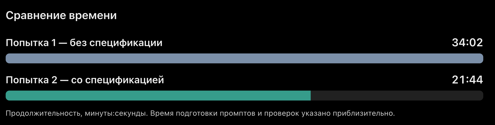

# Отчёт по ДЗ1

Вариант: A

Дата проведения: 10.11.2026

Модель: ChatGPT

Версия модели: GPT-6.2 Sol (средний режим)

## Попытка 1

Время: задание (2 мин 56 сек) + ошибки (всего: 6 мин 6 сек) + промт и проверка (всего: около 25 мин) = 34 мин 2 сек

Число обращений: 6 (1 первоначальный запрос - задача + 5 запросов на исправление) 

Число исправлений: 5  

Обнаруженные ошибки:
1 запрос: Т1, Т2: действие:  отметка «практика» читать. Ожидание: прогресс 25%. Факт: 33% — по числу задач ( 1 мин 7 сек)
2 запрос: Т2:  действие: Отметьте «Практику» выполненной. Ожидание: Выполнено 6 из 8 часов. Факт: Нет показателя сколько из 8 часов выполнено — сумма выполненных часов. (1 мин 1 сек)
3 доп запрос: дополнительные UX-улучшения в виде нумерации и перетаскивания (1 мин 55 сек)  - инициативная проверка добавлена также на попытку 2
4 запрос: Т4: действие: введено число 2,3. Факт: Задача добавляется с часами 2,3. Ожидание:  границы 0,5-24 и шаг 0,5.  (50 сек)
5 запрос: Т4: действие: введен пробел в поле «название». Ожидание: комментарий ошибки. Факт: поле пустое (1 мин 13 сек)

## Попытка 2 — со спецификацией

Время: задание (около 15 мин, проверка написанного + изучение непонятных терминов + сохранение файлов ) + ошибки (1 доп. 1 мин 44 сек ) +  проверка (всего: около 5 мин) = 21 мин 44 сек

Число обращений: 1 задача - создание спецификации + 1 запрос на реализацию HTML + 1 правка

Число исправлений: 1

Обнаруженные ошибки: 
1 доп запрос: дополнительные UX-улучшения в виде нумерации и перетаскивания (1 мин 44 сек)
инициативная проверка добавлена также на попытку 1

## Результаты проверок T1–T5

Проверены финальные версии `tracker-v1-6.html` (без спецификации) и `tracker-v2-2.html` (со спецификацией).

| Проверка | Ожидаемый результат | Версия 1 — без спецификации | Версия 2 — со спецификацией |
|---|---|---|---|
| **T1. Исходные данные** | 3 задачи, 8 ч всего, 2 ч выполнено, прогресс 25% | Первоначально 33% вместо 25%. После исправления — **PASS** | **PASS** — 8 ч, 2 ч выполнено, 25% |
| **T2. Статус задачи** | После выполнения «Практики» — 6 из 8 ч, прогресс 75% | Первоначально прогресс рассчитывался по числу задач; отсутствовал показатель выполненных часов. После исправлений — **PASS** | **PASS** — 6 из 8 ч, 75% |
| **T3. Фильтрация** | Видны «Практика» и «Повторение», общий прогресс остаётся 25% | **PASS** — соответствует ожиданию | **PASS** — соответствует ожиданию |
| **T4. Проверка ввода** | Некорректные данные отклоняются, появляются сообщения об ошибках, значения формы сохраняются | Первоначально принималось 2,3 ч и не всегда отображались ошибки пустых полей. После исправлений — **PASS** | **PASS** — соответствует ожиданию |
| **T5. Пустой список** | После удаления всех задач — 0 ч, 0%, без NaN/Infinity | **PASS** — соответствует ожиданию | **PASS** — соответствует ожиданию |

**Итог:** после исправлений обе версии успешно прошли T1–T5.

Проверки финальных HTML-файлов также были проверены на корректное отображение на ширине 390 px без горизонтальной прокрутки.
Важно отметить, что первая версия содержит три фильтра (так было указано в промте), а во второй версии - только фильтр (активные), при этом в сценариях приемки не указано требование фильтра «готовые». По проверке данного фильтра не требуется - поэтому не стала его изменять. Даже при такой реализации условия проходят проверку Т3, который проверяет только фильтр «Активные».
Из чего можно сделать вывод: качество спецификации зависит не только от ИИ, но и от полноты исходных требований.

Дополнительно добавила запрос на добавление нумерации задач и возможность менять их порядок перетаскиванием (drag-and-drop). Нумерация помогает быстрее ориентироваться в количестве задач, особенно при большом списке, а перетаскивание — самостоятельно менять их последовательность. Эти функции не входили в обязательные требования, но были добавлены в обе версии для сохранения сопоставимости.

## Исправления
Все ошибки были исправлены по 1 запросу.

## Вывод
После обнаружения и исправления ошибок обе версии прошли пять проверок T1–T5. 
При разработке первой версии (без спецификации) потребовались исправления. Прогресс рассчитывался по количеству выполненных задач, а не по часам. Также потребовалось исправить проверку допустимого шага времени и добавить показатель выполненных часов.

Однако ux-ui значительно сильнее, чем в варианте со спецификацией (например, в кнопках ввода есть подсказки, есть tab - фильтр активные и готовые задачи, аккуратнее отображается некорректная запись при добавлении неверного текста или часов задачи, список задач удобнее читать (часы Х расположены под названием задачи) — следовательно, можем предположить, что ограничивая требования, ограничиваем модели самой выбирать лучшие решения. 

При разработке со спецификацией потребовалось больше времени на подготовку и изучение материалов и высокой концентрации, чтобы ничего не упустить из ТЗ, но суммарная работа по второй версии оказалась быстрее и подробное описание позволило заранее проверить все требования и исключить дальнейшие правки и повторную проверку. 

Благодаря эксперименту можно предположить, что для простой задачи модель справляется лучше без спецификации.Сейчас это одностраничный проект с минимум функций - написать точечные правки не вызывает сложностей. Однако, если задача будет более сложная и многоуровневая, возможно, написание спецификации облегчит дальнейшие правки в многоструктурном проекте. 

Первый вариант выполнялся на 12 мин 12 сек дольше второго 

## Ограничения
На основании одного эксперимента нельзя утверждать, что этот способ всегда эффективнее. Была реализована всего лишь одна маленькая задача с использованием одной ИИ-модели. Проверка проводилась по 5 сценариям, отсутствие других ошибок (например, пользовательского опыта UX) не гарантируется. Спецификация создавалась в формате OpenSpec без использования OpenSpec CLI, поэтому эксперимент не оценивает возможности самого инструмента CLI. В исходных запросах для двух версий требования к фильтрам различались: в первой версии были явно перечислены три фильтра («Все», «Активные», «Готовые»), а во второй был указан только сценарий фильтрации активных задач. Поэтому реализации получились немного разными, что может влиять на абсолютную точность их сравнения.

##Токены/стоимость: 
нет данных
